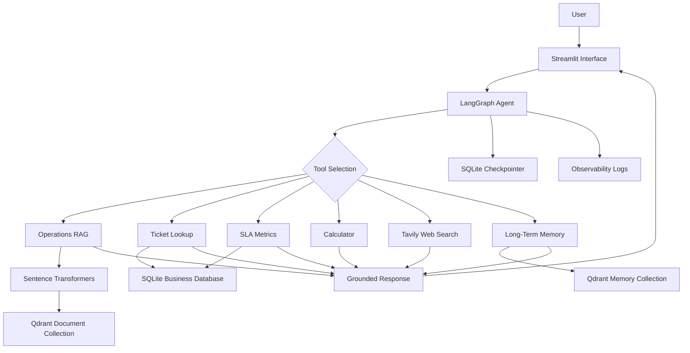

# Autonomous Agentic RAG with Live Data & Memory

An AI-powered Enterprise Operations Copilot that combines Retrieval-Augmented Generation (RAG), autonomous tool selection, live web search, and persistent memory to answer operational questions and complete bounded multi-step tasks.

[](https://www.python.org/)
[](https://www.langchain.com/langgraph)
[](https://streamlit.io/)
[](https://qdrant.tech/)
[]()

## Project Overview

Enterprise teams frequently need to retrieve information from internal policies, investigate support tickets, review operational metrics, and research current information.

This project provides a bounded AI copilot that selects appropriate tools, retrieves relevant internal knowledge, uses approved read-only business operations tools, and maintains conversation and long-term memory.

The system is designed around grounded answers, source transparency, controlled tool execution, and practical enterprise operations workflows.

## Key Features

### 1. Operations Knowledge Base (RAG)
- Upload PDF, DOCX, and TXT documents.
- Extract document text and preserve source metadata.
- Split documents into overlapping chunks.
- Generate embeddings using Sentence Transformers.
- Store and retrieve document chunks using Qdrant.
- Return grounded answers with source filenames and chunk references.
- Apply a retrieval similarity threshold to reduce irrelevant context.
- Respond when available evidence is insufficient.

### 2. Autonomous Agent Workflow
- LangGraph-based tool-calling agent.
- Dynamic tool selection based on user questions.
- Bounded ReAct-style execution workflow.
- Maximum of 4 agent/tool execution steps.
- Error handling and recovery.
- Multi-step operational question handling.

### 3. Integrated Business Tools

| Tool | Purpose |
|---|---|
| Operations RAG | Search internal SOPs and policies |
| Ticket Lookup | Retrieve synthetic support ticket information |
| SLA Lookup | Retrieve operational SLA metrics |
| Calculator | Perform validated arithmetic calculations |
| Live Web Search | Retrieve current information through Tavily |
| Long-Term Memory | Search, save, inspect, and delete user-scoped memories |

### 4. Memory Management

**Short-Term Memory**
- SQLite-backed LangGraph checkpointer.
- Maintains conversation context across turns.
- Uses conversation thread identifiers.

**Long-Term Memory**
- Dedicated Qdrant collection.
- User-scoped memory retrieval.
- Explicit memory saving.
- Memory inspection and deletion.
- Avoids storing credentials and sensitive personal information.

### 5. Security and Execution Controls
- Allow-listed tools.
- Validated tool inputs.
- Read-only SQLite business queries.
- Parameterized SQL queries.
- Safe calculator expression parsing.
- Bounded agent execution.
- Tool timeout and error handling.
- User-scoped memory isolation.

### 6. Observability
- Agent run identifiers.
- Selected tool tracking.
- Tool execution details.
- Source document tracking.
- Execution latency.
- Error logging.
- Run-details panel in the application.

## Technology Stack

| Component | Technology |
|---|---|
| Programming Language | Python 3.12 |
| User Interface | Streamlit |
| Agent Orchestration | LangGraph |
| LLM Provider | Groq API |
| LLM Model | openai/gpt-oss-20b |
| Embeddings | Sentence Transformers |
| Embedding Model | all-MiniLM-L6-v2 |
| Vector Database | Qdrant |
| Short-Term Memory | SQLite Checkpointer |
| Long-Term Memory | Qdrant |
| Live Web Search | Tavily |
| Business Database | SQLite |
| Document Processing | PyPDF, python-docx |
| Testing | Pytest |
| Deployment Target | Streamlit Community Cloud |

## System Architecture



## Project Structure

```text
autonomous-agentic-rag/
│
├── agent/
│   ├── __init__.py
│   ├── graph.py
│   └── tools.py
│
├── rag/
│   ├── __init__.py
│   ├── ingest.py
│   ├── retriever.py
│   ├── generator.py
│   └── vector_store.py
│
├── memory/
│   ├── __init__.py
│   └── store.py
│
├── observability/
│   ├── __init__.py
│   └── logger.py
│
├── data/
│   ├── sample_docs/
│   │   ├── company_sop.txt
│   │   └── asset_return_policy.txt
│   └── demo_ops.db
│
├── tests/
│   └── __init__.py
│
├── app.py
├── config.py
├── init_demo_db.py
├── requirements.txt
├── .env.example
├── .gitignore
└── README.md
```

## Getting Started

### Prerequisites

- Python 3.12
- Git
- A Groq API key
- A Qdrant Cloud account and cluster
- A Tavily API key for live web search

### 1. Clone the Repository

```bash
git clone https://github.com/Shantanu62/autonomous-agentic-rag.git

cd autonomous-agentic-rag
```

### 2. Create a Virtual Environment

**Windows PowerShell:**

```powershell
python -m venv .venv

.\.venv\Scripts\Activate.ps1
```

### 3. Install Dependencies

```powershell
python -m pip install -r requirements.txt
```

### 4. Configure Environment Variables

Create a local environment file:

```powershell
Copy-Item .env.example .env
```

Configure the following values in `.env`:

```env
APP_NAME=Autonomous Agentic RAG with Live Data and Memory
APP_ENV=development

GROQ_API_KEY=your_groq_api_key
GROQ_MODEL=openai/gpt-oss-20b

TAVILY_API_KEY=your_tavily_api_key

QDRANT_URL=your_qdrant_cluster_url
QDRANT_API_KEY=your_qdrant_api_key

QDRANT_DOCUMENT_COLLECTION=operations_documents
QDRANT_MEMORY_COLLECTION=user_long_term_memory

EMBEDDING_MODEL=sentence-transformers/all-MiniLM-L6-v2

RETRIEVAL_LIMIT=5
FINAL_SOURCE_LIMIT=3

MAX_AGENT_STEPS=4

DATABASE_PATH=data/demo_ops.db
CHECKPOINT_DATABASE_PATH=data/agent_checkpoints.sqlite
```

Never commit `.env` or expose API credentials publicly.

### 5. Launch the Application

```powershell
streamlit run app.py
```

Open the local Streamlit URL displayed in your terminal.

On first use, the embedding model may need to download its weights.

## Example Use Cases

### Scenario 1: Internal Policy Question

**Question:**

How many annual paid leave days does an employee receive?

**Expected result:**

The assistant retrieves the relevant company SOP, answers using the available document evidence, and displays the source filename.

### Scenario 2: Asset Return Policy

**Question:**

How many working days do employees have to return company laptops after their last working day?

**Expected result:**

The assistant retrieves `asset_return_policy.txt` and returns the policy requirement of 3 working days.

### Scenario 3: Support Ticket Investigation

**Question:**

What is the current status and priority of ticket TCK-1001?

**Expected result:**

The assistant selects the ticket lookup tool and retrieves the matching synthetic support ticket.

### Scenario 4: SLA Reporting

**Question:**

Summarize the SLA performance for Platform Support in November 2026.

**Expected result:**

The assistant retrieves the corresponding read-only SLA metrics from the business database.

### Scenario 5: Live Web Research

Ask a question requiring current external information.

**Expected result:**

The agent can select the Tavily search tool and provide retrieved web information.

### Scenario 6: Multi-Step Workflow

Combine an internal policy question with a ticket investigation.

**Expected result:**

The agent selects multiple relevant tools within the configured execution limit and combines their results.

## Testing

The project includes automated tests for:

- Document ingestion and chunking.
- Embedding generation.
- Qdrant vector storage and retrieval.
- Source metadata preservation.
- Duplicate retrieval filtering.
- Ticket and SLA tools.
- Calculator validation.
- Web search error handling.
- Agent tool selection and execution.
- Multi-step workflows.
- Short-term and long-term memory.
- Execution limits and error recovery.
- Observability and source tracking.

Run the complete test suite:

```powershell
python -m pytest -q
```

**Latest verified result: 23 tests passed.**

## Deployment

The intended public deployment platform is **Streamlit Community Cloud**.

Deployment workflow:

1. Push the project to GitHub.
2. Connect the repository to Streamlit Community Cloud.
3. Select `app.py` as the application entry point.
4. Configure the required secrets in Streamlit Cloud.
5. Deploy and verify the public application.

Example Streamlit secrets configuration:

```toml
GROQ_API_KEY = "your_groq_api_key"
GROQ_MODEL = "openai/gpt-oss-20b"

TAVILY_API_KEY = "your_tavily_api_key"

QDRANT_URL = "your_qdrant_cluster_url"
QDRANT_API_KEY = "your_qdrant_api_key"
```

The application uses external Groq, Tavily, and Qdrant services. Their availability and free-tier limits may affect the live demo.

## Engineering Principles

- Ground answers in retrieved evidence.
- Keep agent execution bounded.
- Use allow-listed tools instead of unrestricted execution.
- Keep business database queries read-only.
- Separate document storage from user memory.
- Preserve source metadata for traceability.
- Keep credentials outside version control.
- Use synthetic operational data for demonstrations.

## Current Project Status

- [x] Project structure and environment setup
- [x] Operations document ingestion
- [x] Embedding generation
- [x] Qdrant document collection
- [x] Grounded RAG responses
- [x] Source metadata and citations
- [x] Retrieval duplicate filtering
- [x] LangGraph agent and tool integration
- [x] Ticket and SLA lookup
- [x] Calculator and live web search
- [x] SQLite short-term memory
- [x] Qdrant long-term memory
- [x] Execution limits and error recovery
- [x] Observability and run details
- [x] Initial automated regression tests
- [x] GitHub repository published
- [ ] Public Streamlit deployment
- [ ] Final demo video and screenshots

## Limitations

- The project is a portfolio demonstration, not a production-certified enterprise platform.
- Operational records are synthetic.
- External API quotas and service availability may affect responses.
- Retrieval quality depends on document quality, chunking, embeddings, and similarity thresholds.
- Agent execution is deliberately limited to approved tools and a maximum of four steps.

## Author

**Shantanu Anand**

GitHub: [Shantanu62](https://github.com/Shantanu62)

Project Repository: [Autonomous Agentic RAG with Live Data & Memory](https://github.com/Shantanu62/autonomous-agentic-rag)

---

*Built to demonstrate practical Agentic RAG, enterprise operations workflows, tool orchestration, memory management, and controlled AI execution.*
